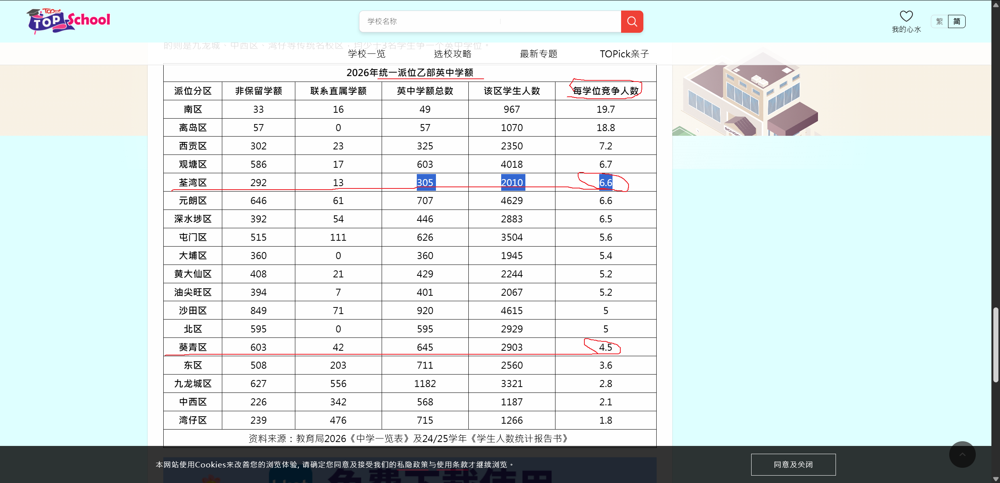

# 2026 荃灣・葵青升中開放日／資訊日 參觀規劃

> 適用：2027年9月入讀中一（現小六）學生家長
> 目標：荃葵青 Band 1–1C 男生為主的自行分配學位選校；**北區列作候補**（有空才考慮）
> 兩人可同行、可分頭行動；**老婆傾向荃灣區下午**，老公行程彈性。
> 🕒 **最後重掃：2026-10-31**（來源：CHSC 學校開放日、各校官網、Goal Edu、聖公會青衣主恩小學「官立及津貼中學宣傳資料」2026/10/30 更新）
> ⚠️ 日期／報名安排隨時變動，出席前先查學校官網確認；標「見校網」者為未取得明確報名連結。

---

## ⚡ 本週必辦（截止日迫近）

| 優先 | 學校             | 事項                                                                | 截止                    |
| ---- | ---------------- | ------------------------------------------------------------------- | ----------------------- |
| 🔴 1 | **林護**   | 11/28 簡介會網上登記（最多 2 位）**實體已滿→改登記網上直播** | **11/20**（直播） |
| 🔴 2 | **何傳耀** | 11/14 講座登記（網上／電話 2496 6000）                              | **11/11 17:00**   |
| 🟠 3 | **伍若瑜** | 12/5 資訊日 11/2 09:00 開放報名                                     | 額滿即止                |
| 🟠 4 | **王少清** | 11/28 簡介會 11/8 10:00 開放報名                                    | 額滿即止                |
| 🟠 5 | **荃官**   | 12/12 資訊日 11/12 起網上報名                                       | 額滿即止                |
| 🟡 6 | **安柱**   | 12/5 資訊日報名                                                     | 11/22 18:00             |
| 🟡 7 | **陳兆民** | 12/5 資訊日報名                                                     | 11/23 17:00             |
| 🟡 8 | **可風**   | 11/28 資訊日報名                                                    | 11/25                   |

---

## 一、總行程表（概覽）

> 一行代表一日；🔷 為北區候補（有空才去）。**報名資訊已併入「老公」欄**（含連結）。老婆只負責荃灣區下午場。
> ✅ 已過日期（10/3、10/10、10/17、10/23、10/24）保留作記錄。

| 日期                                | 老婆（荃灣・下午）                                                                                                                                                       | 老公（彈性．含報名方法／連結）                                                                                                                                                                                                                                                                                                                                 |
| ----------------------------------- | ------------------------------------------------------------------------------------------------------------------------------------------------------------------------ | -------------------------------------------------------------------------------------------------------------------------------------------------------------------------------------------------------------------------------------------------------------------------------------------------------------------------------------------------------------- |
| **10/3、10/10、10/17、10/23** | —                                                                                                                                                                       | ✅ 已完成：主愛小學升中講座（善德／安柱／可風／陳兆民／伍若瑜／石籬／林護）＋10/10 葵青荃灣博覽會                                                                                                                                                                                                                                                              |
| **10/24（六）**               | —                                                                                                                                                                       | ✅ 已完成：李惠利資訊日（葵青）                                                                                                                                                                                                                                                                                                                                |
| **11/7（六）**                | **荃葵青升中博覽 2026**（愉景新城 D.Park 中庭地下）10:00–18:00                                                                                                    | 同上；**免費、無需登記**（廖寶珊亦參展）。可順道即場比較 44 校。                                                                                                                                                                                                                                                                                         |
| **11/13（五）**               | —                                                                                                                                                                       | 晚上 19:00–21:00（18:30 入座）**葵青區升中講座2026「聽誰的？」**（林金殿小學禮堂）。報名見海報 QR；查詢 WhatsApp 6146 7500。                                                                                                                                                                                                                            |
| **11/14（六）**               | （可順道）**李炳** 09:00–12:30 升中資訊日暨模擬面試                                                                                                               | **何傳耀** 09:00–13:00（講座 09:00／11:30，須預約）https://www.twphcymc.edu.hk/ ；**李炳** Google Form：https://docs.google.com/forms/d/e/1FAIpQLScn4-9kPq8CdN0GJGy3Z-onIEH7PW20JVLgk6FjmDqYB1kHDQ/viewform ；棉紡會 09:00–12:00 課堂體驗（葵青）。                                                                                              |
| **11/15（日）**               | —                                                                                                                                                                       | （參考）**保祿六世**（女校）中一自行分配學位簡介會 13:00–14:30，Google Form：https://docs.google.com/forms/d/e/1FAIpQLSeu5AabF5eSOcEpyvMC4TIVKDQqW7nFq7cjYg4HQ4TPkAUcOA/viewform                                                                                                                                                                        |
| **11/21（六）**               | —                                                                                                                                                                       | **全完** 09:00–16:15（10/26 起網上留座：https://forms.gle/XBB1mDqztrRJEnCy9 ）；**吳祥川**（青衣）10:00–12:00／14:00–16:00，Form：https://docs.google.com/forms/d/e/1FAIpQLSdMx6YaztthNXAWJQ4EcpcxQlEJrdEI4eA5ivgdcn-2kRW-5Q/viewform ；棉紡會校慶 09:00–12:30；葉紀南 09:00–13:30；李賢堯 09:30–12:15／14:15–17:00。                       |
| **11/22（日）**               | **梁省德**（荃灣石圍角）11:00–17:00；**呂明才**開放日                                                                                                       | 梁省德 Google Form：https://docs.google.com/forms/d/e/1FAIpQLSfFWShoRYfFymzLD0Hp5weJtXt2QByVzbabDka-Lsp5bmkpIA/viewform ；伍少梅（葵青）09:00–17:00。                                                                                                                                                                                                         |
| **11/27–28（五六）**         | —                                                                                                                                                                       | 🔷候補：上水官立（北區聯校展覽「升中導航」）。                                                                                                                                                                                                                                                                                                                 |
| **11/28（六）**               | ⚡ **可風**（和宜合道 448 號）**09:30–11:00** 或 **11:45–13:15**（兩場內容相同）；**王少清**（大壩街 2 號）14:00–17:00（簡介會 14:30–16:30） | 早上 **林護**（葵盛圍 397 號）09:00–12:00。**可風報名**：https://forms.gle/EdXR5hy6rp2h9N6PA （截止 11/25，每家庭最多 2 人）；**王少清簡介會**：11/8 10:00 起 https://www.eventbrite.hk/e/2003800383889 （校園開放免報名）；**林護實體簡介會已滿，改登記網上直播（同 11/28 09:00，11/20 截止）**：https://forms.gle/cgXbuVCe64i5RfXN9 |
| **11/29（日）**               | **聖芳濟** 09:30–10:30 講座／10:30–13:00 荃濟遊；**李城璧** 09:00–14:00（講座 10:00–11:15）                                                              | **李城璧** Google Form：https://forms.gle/CVFX22XQdDr4NDRa7 （開放日免報名）；**聖芳濟** Google Form：https://forms.gle/XT2j7HUSEVCmtBdy6 （截止 11/27）；下午 **荔景天主教**：講座 14:00–15:00、開放日 15:00–17:00。                                                                                                                      |
| **12/5（六）**                | **廖寶珊**（蕙荃路 22–66 號）待公布；或 **姚連生** 13:30–16:00（荃灣石圍角）                                                                               | ⚡ 三選一：**安柱** 09:30–12:00／14:00–16:30（Form，11/22 截止）＋**善德** 13:30–17:00（免報名，講座 14:30）；或 **羅傑承** 09:15–13:15；或 **陳兆民** 10:00–11:30／14:00–15:30（Form，11/23 截止）。**伍若瑜** 09:00–16:30（11/2 起報名）。                                                                              |
| **12/6（日）**                | 休息                                                                                                                                                                     | **陳兆民 55 周年校慶活動日**（12/5–6，可補 12/5 未去）；🔷候補北區（馬錦明 10:00–12:45、廖萬石堂 14:00–16:30）。                                                                                                                                                                                                                                      |
| **12/12（六）**               | **荃官**（海壩街 70 號）**08:30–10:15** 或 **11:15–13:00**（兩場內容相同，11/12 起網上報名）                                                         | 早上 **李兆基**（葵盛圍 303 號）10:00–11:30；下午可選第二節 14:30–16:00。網上報名 10/28 09:00–12/5 12:00（600 座先到先得）：https://www.lskc.edu.hk/en/content.php?wid=214                                                                                                                                                                            |
| **12/19（六）**               | —                                                                                                                                                                       | 石籬天主教 45 周年校慶開放日 10:00–14:00（12/20 12:30–16:30）；🔷候補：馬錦燦 09:00–16:35。                                                                                                                                                                                                                                                                 |

> 🔸 **分工原則**：老婆**只負責荃灣區下午場**；其餘**葵青區、上午、晚間**的活動一律由老公負責（含所有報名登記）。11/28、11/29、12/5、12/12 四日需分頭。
>
> **已有明確報名連結**：林護、何傳耀、可風、王少清、荃官、李兆基、安柱、善德（免報名）、羅傑承、陳兆民、伍若瑜、李城璧、聖芳濟、蘇浙、圓玄一中、全完、吳祥川、燕京、梁省德、李炳、蕭明、保祿六世、棉紡會、裘錦秋、李賢堯、伍少梅；**免報名／先到先得**：善德、荃葵青升中博覽（11/7）、主愛講座；其餘標「見校網」。
>
> 🎯 **真正撞期**：11/28、11/29、12/5、12/12，全部用「老婆荃灣 ＋ 老公葵青」分擔。重點校 9 間中，**11/28 可風＋林護**、**12/5 安柱＋善德**、**12/12 荃官＋李兆基**、**11/14 何傳耀**、**11/28 王少清** 已覆蓋；陳兆民改為 12/5 或 12/6 校慶日補回。

---

## 一之二、每日詳細行程（時間・地點・交通）

> 校方公布的固定時段已註明；未公布者用「建議時段＋待公布」標示。所有時間為建議，實際以學校當日安排為準。

### 📅 11/7（六）荃葵青升中博覽 ｜兩人同行（荃灣）

| 時間         | 行程                                                                                           | 地點／交通                                                                         |
| ------------ | ---------------------------------------------------------------------------------------------- | ---------------------------------------------------------------------------------- |
| 10:00–13:00 | **荃葵青升中博覽 2026**（44 校攤位；主力問可風、王少清、荃官、林護、安柱、善德、陳兆民） | 愉景新城 D.Park 中庭地下（荃灣青山公路荃灣段 398 號；荃灣站 A3 出口步行約 8 分鐘） |
| 13:00–14:30 | 午飯                                                                                           | 愉景新城／荃灣廣場                                                                 |
| 14:30–18:00 | 繼續博覽或先行離開（免費入場、無需登記）                                                       | 同上                                                                               |

### 📅 11/14（六）何傳耀 ＋ 李炳 ｜⚡ 分開（荃灣上午）

| 時間         | 老公                                                                               | 老婆                                                                          |
| ------------ | ---------------------------------------------------------------------------------- | ----------------------------------------------------------------------------- |
| 08:30        | 荃灣站集合                                                                         | —                                                                            |
| 09:00–10:30 | **何傳耀紀念中學** 開放日｜S1 講座第一場 09:00（須預約，憑電子門票 QR 入場） | **李炳中學** 09:00–12:30 升中資訊日暨模擬面試工作坊（和宜合道 450 號） |
| 11:30–13:00 | 何傳耀 講座第二場 11:30（可選）／校園參觀                                          | 李炳（可提早離開）                                                            |
| 13:00        | 散場；順路可看同邨姚連生                                                           | 荃灣站                                                                        |

### 📅 11/21（六）全完 ＋ 吳祥川 ｜老公單人（葵青）

| 時間         | 行程                                                              | 地點／交通                                         |
| ------------ | ----------------------------------------------------------------- | -------------------------------------------------- |
| 08:45        | 葵芳站集合                                                        | 港鐵葵芳站                                         |
| 09:00–11:30 | **中華基督教會全完中學** 升中資訊日（講座＋攤位＋課堂體驗） | 葵涌邨上角街 15 號（葵芳站轉 31M／43A 約 10 分鐘） |
| 11:30–13:30 | 午飯＋往青衣                                                      | 葵芳／青衣城                                       |
| 14:00–16:00 | **東華三院吳祥川紀念中學** 第二場                           | 青衣市中心清心街 7 號（青衣站步行約 8 分鐘）       |
| 16:00        | 散場                                                              | 青衣站                                             |

### 📅 11/28（六）可風 ＋ 王少清 ＋ 林護 ｜⚡ 分開

| 時間         | 老公（葵青）                                                                                                                            | 老婆（荃灣）                                                                                                                                                   |
| ------------ | --------------------------------------------------------------------------------------------------------------------------------------- | -------------------------------------------------------------------------------------------------------------------------------------------------------------- |
| 08:30        | 葵芳站集合                                                                                                                              | —                                                                                                                                                             |
| 09:00–12:00 | **聖公會林護紀念中學**（1A 衝）：新界葵涌葵盛圍 397 號（葵興站步行約 12–15 分鐘，或轉 31M／43A；禮堂約 1000 座，憑確認電郵入座） | **可風中學**（1B–1A 衝）第一場 09:30–11:00：新界葵涌和宜合道 448 號（荃灣站／大窩口站轉 32M、46X 等巴士約 15 分鐘）                                    |
| 11:00–13:30 | 午飯（可與老婆會合）                                                                                                                    | 可風第二場 11:45–13:15（如首場滿座）；或直接午飯                                                                                                              |
| 13:30–14:00 | —                                                                                                                                      | 前往大壩街                                                                                                                                                     |
| 14:00–17:00 | —                                                                                                                                      | **寶安商會王少清中學**（1B 目標）開放日：新界荃灣大壩街 2 號（近荃灣站，步行約 8–10 分鐘）；**中一入學簡介會 14:30–16:30（1 樓禮堂，先到先得）** |
| 17:00        | 散場                                                                                                                                    | 荃灣站                                                                                                                                                         |

> ⚠️ 可風兩場內容相同，建議老婆取 **09:30 第一場**，之後午飯、14:00 前到王少清排隊入座（簡介會名額有限、先到先得）。

### 📅 11/29（日）李城璧 ＋ 聖芳濟 ＋ 荔景 ｜⚡ 分開

| 時間         | 老公                                                                                         | 老婆                                                                                                                           |
| ------------ | -------------------------------------------------------------------------------------------- | ------------------------------------------------------------------------------------------------------------------------------ |
| 09:00        | —                                                                                           | **聖芳濟中學**（男校）09:30–10:30「升中資訊講座」、10:30–13:00「荃濟遊」體驗（咸田街 60–64 號，荃灣站步行約 12 分鐘） |
| 10:00–11:15 | **保良局李城璧中學**（2A 保險）09:30 入座、10:00–11:15 講座（荃景圍安賢街 12–20 號） | 聖芳濟體驗活動                                                                                                                 |
| 11:15–14:00 | 李城璧開放日 09:00–14:00（免報名，攤位／學科體驗）                                          | 聖芳濟（至 13:00）→ 午飯                                                                                                      |
| 14:00–17:00 | **荔景天主教中學**（葵青）：講座 14:00–15:00、開放日 15:00–17:00                     | 休息／回程                                                                                                                     |
| 17:00        | 散場                                                                                         | —                                                                                                                             |

### 📅 12/5（六）安柱 ＋ 善德 ｜⚡ 分開（建議方案）

| 時間         | 老公（葵青）                                                                                                                                                | 老婆（荃灣・下午）                                                                                                                                                          |
| ------------ | ----------------------------------------------------------------------------------------------------------------------------------------------------------- | --------------------------------------------------------------------------------------------------------------------------------------------------------------------------- |
| 09:00        | 葵芳站集合                                                                                                                                                  | —                                                                                                                                                                          |
| 09:30–12:00 | **中華傳道會安柱中學** 第一場（1B–1A 衝）：新界葵涌梨貝街 6 號（葵芳／葵興站轉的士約 8 分鐘）                                                        | —                                                                                                                                                                          |
| 12:00–13:30 | 午飯＋往善德                                                                                                                                                | 荃灣站集合、午飯                                                                                                                                                            |
| 13:30–17:00 | **佛教善德英文中學**（1B–1A 衝）：新界葵涌興盛路 5 號（葵芳站步行約 10–12 分鐘）；攤位 13:30–14:30，**講座 14:30–16:00**，16:00–17:00 攤位 | **廖寶珊紀念書院**（保險）：新界荃灣蕙荃路 22–66 號（荃灣站步行約 10 分鐘）下午場，**待公布**；或改去 **姚連生** 體藝科技嘉年華 13:30–16:00（石圍角邨） |
| 17:00        | 散場                                                                                                                                                        | 荃灣站                                                                                                                                                                      |

> ❗ **12/5 同日撞期取捨**：羅傑承（09:15–13:15）、陳兆民（10:00–11:30／14:00–15:30）、伍若瑜（09:00–16:30）與安柱／善德重疊，無法全去。
> 建議：以層級較高的 **安柱＋善德** 為主；羅傑承若已報名可只取簡章／校網資料；陳兆民可改 **12/6 校慶活動日** 補看；伍若瑜改為只索取資料。

### 📅 12/6（日）陳兆民校慶 ｜老公單人（補 12/5）

| 時間         | 行程                                                                        | 地點／交通                                                     |
| ------------ | --------------------------------------------------------------------------- | -------------------------------------------------------------- |
| 13:30        | 葵芳站集合                                                                  | 港鐵葵芳站                                                     |
| 14:00–17:00 | **東華三院陳兆民中學** 55 周年校慶活動日（1C–1B 目標；12/5–6 兩日） | 新界葵涌葵盛葵合街 1–5 號（葵芳站轉 31M／43A 約 10–12 分鐘） |

### 📅 12/12（六）李兆基 ＋ 荃官 ｜⚡ 分開

| 時間         | 老公（葵青）                                                                                                 | 老婆（荃灣）                                                                                               |
| ------------ | ------------------------------------------------------------------------------------------------------------ | ---------------------------------------------------------------------------------------------------------- |
| 08:15        | —                                                                                                           | 荃灣站集合                                                                                                 |
| 08:30–10:15 | 葵芳站集合、往李兆基                                                                                         | **荃灣官立中學** 第一場（1A 衝）：新界荃灣海壩街 70 號（荃灣站步行約 10 分鐘）；學生表演＋升中座談會 |
| 10:00–11:30 | **順德聯誼總會李兆基中學**（1C 穩）第一場：新界葵涌葵盛圍 303 號（葵芳站轉 31M／43A，或的士約 8 分鐘） | 荃官（至 10:15）；或改取第二場 11:15–13:00                                                                |
| 11:30–14:30 | 午飯（可會合）                                                                                               | 午飯                                                                                                       |
| 14:30–16:00 | （可選）李兆基第二場                                                                                         | 自由時間                                                                                                   |
| 16:00        | 散場                                                                                                         | 荃灣站                                                                                                     |

> ⏰ **報名提醒**：荃官 11/12 起網上報名（額滿即止，兩場內容相同，建議取 08:30 場）；李兆基 10/28 09:00–12/5 12:00 網上報名（600 座先到先得）。

---

## 二、全區開放日／資訊日時間表

### ① 聯合博覽／講座

| 活動                                     | 日期                 | 時間                       | 地點                                                  | 報名方法                                            |
| ---------------------------------------- | -------------------- | -------------------------- | ----------------------------------------------------- | --------------------------------------------------- |
| **荃葵青升中博覽 2026**            | 2026年11月7日（六）  | 10:00–18:00               | 愉景新城 D.Park 中庭地下（荃灣青山公路荃灣段 398 號） | **免費入場、無需登記**；44 校攤位，廖寶珊參展 |
| **葵青區升中講座2026「聽誰的？」** | 2026年11月13日（五） | 19:00–21:00（18:30 入座） | 佛教林金殿紀念小學禮堂（葵芳邨第五期，葵芳站 D 出口） | 網上報名（見海報 QR）；查詢 WhatsApp 6146 7500      |
| 2026葵青及荃灣中學博覽會                 | 2026年10月10日（六） | 10:00–17:00               | 佛教林金殿紀念小學禮堂                                | ✅ 已舉行                                           |

> 主辦：葵青區家長教師會聯會；協辦：荃灣葵涌及青衣區中學校長會。11/7 博覽由荃灣區家長教師會聯會主辦。

### ② 荃灣區目標學校（Band 1）

| 學校（層級）                      | 開放日／資訊日 | 時間                                                                          | 報名方法                                                                                                                                    | 連結                                            |
| --------------------------------- | -------------- | ----------------------------------------------------------------------------- | ------------------------------------------------------------------------------------------------------------------------------------------- | ----------------------------------------------- |
| **何傳耀紀念中學**（1B 衝） | 11/14（六）    | 09:00–13:00（講座 09:00／11:30 兩場，內容相同；校園參觀至 13:00）            | 網上／電話 2496 6000／經小學；**登記 10/26 10:00–11/11 17:00**；成功即收電子門票 QR                                                  | https://www.twphcymc.edu.hk/                    |
| **可風中學**（1B–1A 衝）   | 11/28（六）    | **09:30–11:00**／**11:45–13:15**（兩場內容相同）                | **Google Form**（每家庭最多 2 人，先到先得）：https://forms.gle/EdXR5hy6rp2h9N6PA ，截止 **11/25**                              | https://www.hofung.edu.hk/                      |
| **王少清中學**（1B 目標）   | 11/28（六）    | **14:00–17:00**（校園開放）；**簡介會 14:30–16:30**（1 樓禮堂） | 校園開放**免報名**；簡介會 **11/8 10:00 起** Eventbrite：https://www.eventbrite.hk/e/2003800383889 （額滿即止，設錄影上載校網） | https://www.pocawsc.edu.hk/en/form-1-admission/ |
| **荃灣官立中學**（1A 衝）   | 12/12（六）    | **08:30–10:15**／**11:15–13:00**（兩場內容相同）                | **11/12 起網上報名**（額滿即止）；電話 2490 3307                                                                                      | https://www.twgss.edu.hk/                       |
| **廖寶珊紀念書院**（保險）  | 12/5（六）     | 待公布（校曆僅列 11/7 升中博覽；Goal Edu 列 12/5 開放日）                     | 見校網                                                                                                                                      | https://www.lpsmc.edu.hk/                       |

### ③ 葵青區目標學校（Band 1）

| 學校（層級）                            | 開放日／資訊日                                       | 時間                                                                                   | 報名方法                                                                                                                                                                     | 連結                                                                                                            |
| --------------------------------------- | ---------------------------------------------------- | -------------------------------------------------------------------------------------- | ---------------------------------------------------------------------------------------------------------------------------------------------------------------------------- | --------------------------------------------------------------------------------------------------------------- |
| **林護紀念中學**（1A 衝）         | 11/28（六）                                          | **09:00–12:00**（禮堂約 1000 座）                                               | **實體已滿**；實體登記 10/26 09:00–11/9 17:00 已截止。**網上直播登記**：https://forms.gle/cgXbuVCe64i5RfXN9 ，**11/20 截止**；11/25 前確認電郵            | https://www.lamwoo.edu.hk/notice_detail.php?id=246                                                              |
| **李兆基中學**（1C 穩）           | 12/12（六）                                          | 第一節 10:00–11:30；第二節 14:30–16:00                                               | **10/28 09:00–12/5 12:00** 網上報名；600 座先到先得：https://docs.google.com/forms/d/e/1FAIpQLSctiXFYq9Nqc9ow4-Qqh26zsuHhX9m4-JnL14i6rhuW8Kxc6Q/viewform              | https://www.lskc.edu.hk/en/content.php?wid=214                                                                  |
| **羅傑承(1983)中學**（1C–1B 穩） | 12/5（六）                                           | **09:15–13:15**                                                                 | **Google Form**：https://docs.google.com/forms/d/e/1FAIpQLSeV77xe9eUC8HRKD801Clphz_90mlOTh5oGOreVfxQ3c3jKTw/viewform                                                   | https://www.plk83.edu.hk/                                                                                       |
| **陳兆民中學**（1C–1B 目標）     | **12/5（六）**（另 12/5–6 55 周年校慶活動日） | **10:00–11:30／14:00–15:30**（講座後校園參觀）                                 | **Google Form**：https://docs.google.com/forms/d/e/1FAIpQLSczjzTMcjeb-uHr0nd4B9h14HcSIyHyJxO70tIRM0WWyVakFA/viewform ，截止 **11/23 17:00**；不設即場報名        | https://www.twghczm.edu.hk/                                                                                     |
| **安柱中學**（1B–1A 衝）         | 12/5（六）                                           | **09:30–12:00／14:00–16:30**                                                   | **Google Form**（10/1 12:00–11/22 18:00）：https://docs.google.com/forms/d/e/1FAIpQLScbINYnT95RgGSzTTMMoDpnqO7rKxYRuKMehutg3_cgXns8xw/viewform                        | https://www.cneccc.edu.hk/event-details/f-1-admission-information-day-2027-28-zhong-yi-ru-xue-zi-xun-ri-2027-28 |
| **善德英文中學**（1B–1A 衝）     | 12/5（六）                                           | **13:30–17:00**（攤位 13:30–14:30、16:00–17:00；**講座 14:30–16:00**） | **免報名、先到先得**（禮堂滿座開放課室直播）                                                                                                                           | https://www.bstc.edu.hk/CustomPage/117/School_Promotion_Day.htm                                                 |
| **伍若瑜夫人紀念中學**（2B–2A）  | 12/5（六）                                           | **09:00–16:30**（升中資訊日暨學習成果展）                                       | **11/2 09:00 起**：資訊講座 https://forms.gle/nLZdK7w26n5f1o5t9 ；另有英語體驗課／模擬面試班 https://forms.gle/VDvNe2m9cB6gwfgq6 、https://forms.gle/d5is7qevEnAey93D6 | https://www.twghwyyms.edu.hk/article/723                                                                        |
| 保祿六世書院（1B 女校，參考）           | 11/15（日）                                          | 13:00–14:30                                                                           | Google Form：https://docs.google.com/forms/d/e/1FAIpQLSeu5AabF5eSOcEpyvMC4TIVKDQqW7nFq7cjYg4HQ4TPkAUcOA/viewform                                                             | http://www.ppaulvi.edu.hk/                                                                                      |
| 天主教母佑會蕭明中學（女校，參考）      | 11/28（六）                                          | **10:30–16:30**                                                                 | 網上報名：https://dmhcsm.ievent.hk/event/infoday2026                                                                                                                         | https://www.dmhcsm.edu.hk/tc                                                                                    |

### ④ 葵青區其他學校（Band 2／3）

| 學校                                             | 開放日／資訊日                                             | 時間                                                                 | 報名方法                                                                                                                                                                                                                      |
| ------------------------------------------------ | ---------------------------------------------------------- | -------------------------------------------------------------------- | ----------------------------------------------------------------------------------------------------------------------------------------------------------------------------------------------------------------------------- |
| 中華基督教會全完中學                             | 11/21（六）                                                | **09:00–16:15**（講座、攤位、課堂體驗；10/26 起留座）         | 網上：https://forms.gle/XBB1mDqztrRJEnCy9                                                                                                                                                                                     |
| 東華三院吳祥川紀念中學                           | 11/21（六）                                                | **10:00–12:00／14:00–16:00**                                 | Google Form：https://docs.google.com/forms/d/e/1FAIpQLSdMx6YaztthNXAWJQ4EcpcxQlEJrdEI4eA5ivgdcn-2kRW-5Q/viewform                                                                                                              |
| 佛教葉紀南紀念中學                               | 11/21（六）                                                | **09:00–13:30**                                               | 見校網                                                                                                                                                                                                                        |
| 棉紡會中學（校慶開放日）                         | 11/21（六）                                                | **09:00–12:30**；另 11/14、11/28 09:00–12:00 中一課堂體驗日  | 課堂體驗 Form：https://docs.google.com/forms/d/e/1FAIpQLSdx87RKa8Hhsb8u3f3-ui24byG5Kw81qqqUDETIKNMliMZSJw/viewform ；校慶 https://docs.google.com/forms/d/e/1FAIpQLSdISiO6f79SIX330fgfuCHbcWWNGATZav9lbwrKgzLCDzpfHw/viewform |
| 中華傳道會李賢堯紀念中學                         | 11/21（六）                                                | 09:30–12:15／14:15–17:00                                           | Google Form：https://docs.google.com/forms/d/e/1FAIpQLSce-xvtA0dXg45-cQWljZp_AQeVULV4rrG4E6F-2DqQHvwqCQ/viewform                                                                                                              |
| 天主教慈幼會伍少梅中學（男校）                   | 11/22（日）                                                | 09:00–17:00                                                         | Google Form：https://docs.google.com/forms/d/e/1FAIpQLSe80_8-6B0kDKTjHSPDOU4wGU9zlycDalrBV0XRrWUFHAsLFg/viewform                                                                                                              |
| 葵涌蘇浙公學（STEAM 愛心嘉年華）                 | 11/28（六）                                                | **13:00–16:30**（13:00 開幕、13:15 起攤位）                   | **10/2 起報名**：https://docs.google.com/forms/d/e/1FAIpQLSfzpW4FI1QFfo5Yv8OSp6RE9hSByGIpHxEHXM_ylKjE-Sk78g/viewform                                                                                                    |
| 圓玄學院第一中學（學校資訊日）                   | 11/28（六）                                                | **10:00–17:00**（升中簡介會、體驗課、校園展室）               | 網上報名：https://s.yy1.edu.hk/openday （費用全免、額滿即止）                                                                                                                                                                 |
| 中華基督教會燕京書院（升中講座暨體驗日）         | 11/28（六）                                                | **14:00–16:30**                                               | Google Form：https://docs.google.com/forms/d/e/1FAIpQLScnUxHfH4GDIeqxpZknJMhXM8A_DA6244jlLMVeUSuJTm31PQ/viewform                                                                                                              |
| 樂善堂顧超文中學                                 | 11/28（六）                                                | **10:00–10:45／13:45–14:30**                                 | 見校網                                                                                                                                                                                                                        |
| 獅子會蔣翠琼中學（開放日暨升中資訊日）           | 11/28（六）                                                | **09:00–16:00**                                               | 見校網                                                                                                                                                                                                                        |
| 香港四邑商工總會陳南昌紀念中學（「我的航天夢」） | 11/28（六）                                                | **13:00–18:30**                                               | 見校網                                                                                                                                                                                                                        |
| 葵涌循道中學（葵循資訊日）                       | 11/28（六）                                                | **09:00–12:30／14:00–16:00**                                 | 見校網                                                                                                                                                                                                                        |
| 裘錦秋中學（葵涌）                               | 11/28（六）                                                | **14:15–16:30**                                               | Google Form：https://docs.google.com/forms/d/e/1FAIpQLSeXqRL5L4V_zRI7zpUuZtHipulJCekhtCvfvkX7owawsIBp6A/viewform                                                                                                              |
| 嶺南鍾榮光博士紀念中學                           | 11/28（六）、11/29（日）                                   | 11/28 10:00–12:00 模擬面試、13:00–17:00 開放日；11/29 10:00–16:00 | 見校網                                                                                                                                                                                                                        |
| 荔景天主教中學                                   | 11/29（日）                                                | **講座 14:00–15:00；開放日 15:00–17:00**                     | 見校網                                                                                                                                                                                                                        |
| 迦密愛禮信中學（資訊日）                         | 12/5（六）                                                 | **10:00–16:30**                                               | 見校網                                                                                                                                                                                                                        |
| 石籬天主教中學（45 周年校慶開放日）              | **12/19（六）10:00–14:00；12/20（日）12:30–16:30** | 見左                                                                 | 見校網                                                                                                                                                                                                                        |

### ⑤ 荃灣區其他學校（Band 2／3，區內共 14 所）

| 學校                                                     | 開放日／資訊日                                                  | 時間                                                 | 報名方法                                                                                                         |
| -------------------------------------------------------- | --------------------------------------------------------------- | ---------------------------------------------------- | ---------------------------------------------------------------------------------------------------------------- |
| **聖公會李炳中學**（升中資訊日暨模擬面試工作坊）   | 11/14（六）                                                     | **09:00–12:30**                               | Google Form：https://docs.google.com/forms/d/e/1FAIpQLScn4-9kPq8CdN0GJGy3Z-onIEH7PW20JVLgk6FjmDqYB1kHDQ/viewform |
| **明愛聖若瑟中學**（中一入學簡介會及校園導賞）     | 11/14（六）                                                     | 10:00–11:30                                         | 見校網                                                                                                           |
| **博愛醫院歷屆總理聯誼會梁省德中學**（學校資訊日） | 11/22（日）                                                     | **11:00–17:00**                               | Google Form：https://docs.google.com/forms/d/e/1FAIpQLSfFWShoRYfFymzLD0Hp5weJtXt2QByVzbabDka-Lsp5bmkpIA/viewform |
| **路德會呂明才中學**                               | 11/22（日）開放日；**11/28（六）09:00–13:00 升中資訊日** | 見左                                                 | 見校網                                                                                                           |
| **荃灣聖芳濟中學**（男校；升中資訊日 x 荃濟遊）    | 11/29（日）                                                     | 09:30–10:30 講座；10:30–13:00 體驗活動             | **Google Form**（截止 11/27）或致電 2492 0226 彭小姐：https://forms.gle/XT2j7HUSEVCmtBdy6                  |
| **保良局李城璧中學**（升中資訊講座及開放日）       | 11/29（日）                                                     | 講座 10:00–11:15（09:30 入座）；開放日 09:00–14:00 | **講座需 Google Form 報名**（11/20 前確認）；開放日免報名：https://forms.gle/CVFX22XQdDr4NDRa7             |
| **保良局姚連生中學**（體藝科技嘉年華）             | 12/5（六）                                                      | **13:30–16:00**                               | 掃 QR／Google Form：https://forms.gle/7baXJi4ENjEXaGHC8 （名額有限）                                             |
| **路德會呂明才中學**（金禧開放日暨 50 周年特展）   | 10/17（六）                                                     | 10:30–17:00                                         | ✅ 已舉行                                                                                                        |
| **保良局姚連生中學**（學校資訊日）                 | 10/17（六）                                                     | 14:00–17:00                                         | ✅ 已舉行                                                                                                        |
| **仁濟醫院林百欣中學**                             | 未公布／見校網                                                  | —                                                   | 見校網                                                                                                           |
| **紡織學會美國商會胡漢輝中學**                     | 未公布／見校網                                                  | —                                                   | 見校網                                                                                                           |
| 香港蔚來中學（私立）                                     | 未公布                                                          | —                                                   | 私校                                                                                                             |

> ℹ️ 荃灣區另有 荃官、可風、王少清、何傳耀、廖寶珊（見②）；以上為其餘學校。

---

### ⑥ 區內小學升中家長講座（已完成）

> 資料來源：聖公會主愛小學通告（2026年9月8日，第 25 號）。由區內中學校長到小學主講。以下場次**均已完成**，記錄作參考。

| 日期        | 時段                | 主講中學               | 狀態    |
| ----------- | ------------------- | ---------------------- | ------- |
| 10/3（六）  | 09:00／10:15／11:30 | 善德、安柱、保良局世德 | ✅ 完成 |
| 10/10（六） | 09:00／10:15        | 可風、陳兆民           | ✅ 完成 |
| 10/17（六） | 09:00／10:15        | 伍若瑜、石籬天主教     | ✅ 完成 |
| 10/23（五） | 14:00               | 林護                   | ✅ 完成 |

---

## 三、報名時間表（按截止日排序）

> 已重掃至 2026-10-31；「已開放」表示現已可報。報名前請再按連結確認名額。

| #  | 截止                         | 學校                                                                                       | 開放日              | 報名方式／連結                                                                                                   |
| -- | ---------------------------- | ------------------------------------------------------------------------------------------ | ------------------- | ---------------------------------------------------------------------------------------------------------------- |
| 1  | **11/20** 🔴           | **林護**                                                                             | 11/28               | 實體已滿；**網上直播登記**（11/20 截止）：https://forms.gle/cgXbuVCe64i5RfXN9                              |
| 2  | **11/11 17:00** 🔴     | **何傳耀**                                                                           | 11/14               | 網上（校網 QR）／電話 2496 6000／經小學：https://www.twphcymc.edu.hk/                                            |
| 3  | **11/22 18:00**        | **安柱**                                                                             | 12/5                | Google Form：https://docs.google.com/forms/d/e/1FAIpQLScbINYnT95RgGSzTTMMoDpnqO7rKxYRuKMehutg3_cgXns8xw/viewform |
| 4  | **11/23 17:00**        | **陳兆民**                                                                           | 12/5                | Google Form：https://docs.google.com/forms/d/e/1FAIpQLSczjzTMcjeb-uHr0nd4B9h14HcSIyHyJxO70tIRM0WWyVakFA/viewform |
| 5  | **11/25**              | **可風**                                                                             | 11/28               | Google Form（每家庭最多 2 人）：https://forms.gle/EdXR5hy6rp2h9N6PA                                              |
| 6  | **11/27**              | **荃灣聖芳濟**                                                                       | 11/29               | Google Form：https://forms.gle/XT2j7HUSEVCmtBdy6                                                                 |
| 7  | **12/5 12:00**         | **李兆基**                                                                           | 12/12               | 網上（600 座先到先得）：https://www.lskc.edu.hk/en/content.php?wid=214                                           |
| 8  | **11/20 前確認**       | **李城璧**                                                                           | 11/29               | Google Form：https://forms.gle/CVFX22XQdDr4NDRa7 （開放日免報名）                                                |
| 9  | **11/2 09:00 開放** 🟠 | **伍若瑜**                                                                           | 12/5                | https://forms.gle/nLZdK7w26n5f1o5t9 （額滿即止）                                                                 |
| 10 | **11/8 10:00 開放** 🟠 | **王少清**                                                                           | 11/28               | Eventbrite：https://www.eventbrite.hk/e/2003800383889 （校園開放免報名）                                         |
| 11 | **11/12 開放** 🟠      | **荃官**                                                                             | 12/12               | 校網網上系統（額滿即止）：https://www.twgss.edu.hk/                                                              |
| 12 | 已開放                       | **羅傑承**                                                                           | 12/5                | Google Form：https://docs.google.com/forms/d/e/1FAIpQLSeV77xe9eUC8HRKD801Clphz_90mlOTh5oGOreVfxQ3c3jKTw/viewform |
| 13 | 已開放                       | **全完**                                                                             | 11/21               | Google Form：https://forms.gle/XBB1mDqztrRJEnCy9                                                                 |
| 14 | 已開放                       | **吳祥川**                                                                           | 11/21               | Google Form：https://docs.google.com/forms/d/e/1FAIpQLSdMx6YaztthNXAWJQ4EcpcxQlEJrdEI4eA5ivgdcn-2kRW-5Q/viewform |
| 15 | 已開放                       | **李炳**                                                                             | 11/14               | Google Form：https://docs.google.com/forms/d/e/1FAIpQLScn4-9kPq8CdN0GJGy3Z-onIEH7PW20JVLgk6FjmDqYB1kHDQ/viewform |
| 16 | 已開放                       | **梁省德**                                                                           | 11/22               | Google Form：https://docs.google.com/forms/d/e/1FAIpQLSfFWShoRYfFymzLD0Hp5weJtXt2QByVzbabDka-Lsp5bmkpIA/viewform |
| 17 | 已開放                       | **燕京**                                                                             | 11/28               | Google Form：https://docs.google.com/forms/d/e/1FAIpQLScnUxHfH4GDIeqxpZknJMhXM8A_DA6244jlLMVeUSuJTm31PQ/viewform |
| 18 | 已開放                       | **蘇浙**                                                                             | 11/28               | Google Form：https://docs.google.com/forms/d/e/1FAIpQLSfzpW4FI1QFfo5Yv8OSp6RE9hSByGIpHxEHXM_ylKjE-Sk78g/viewform |
| 19 | 已開放                       | **裘錦秋（葵涌）**                                                                   | 11/28               | Google Form：https://docs.google.com/forms/d/e/1FAIpQLSeXqRL5L4V_zRI7zpUuZtHipulJCekhtCvfvkX7owawsIBp6A/viewform |
| 20 | 已開放                       | **李賢堯**                                                                           | 11/21               | Google Form：https://docs.google.com/forms/d/e/1FAIpQLSce-xvtA0dXg45-cQWljZp_AQeVULV4rrG4E6F-2DqQHvwqCQ/viewform |
| 21 | 已開放                       | **伍少梅**                                                                           | 11/22               | Google Form：https://docs.google.com/forms/d/e/1FAIpQLSe80_8-6B0kDKTjHSPDOU4wGU9zlycDalrBV0XRrWUFHAsLFg/viewform |
| 22 | 已開放                       | **棉紡會**                                                                           | 11/14、11/21、11/28 | 見「④」兩個 Form                                                                                                |
| 23 | 已開放                       | **圓玄一中**                                                                         | 11/28               | https://s.yy1.edu.hk/openday                                                                                     |
| 24 | 已開放                       | **蕭明**                                                                             | 11/28               | https://dmhcsm.ievent.hk/event/infoday2026                                                                       |
| 25 | 已開放                       | **保祿六世**                                                                         | 11/15               | Google Form：https://docs.google.com/forms/d/e/1FAIpQLSeu5AabF5eSOcEpyvMC4TIVKDQqW7nFq7cjYg4HQ4TPkAUcOA/viewform |
| — | **免報名**             | 善德                                                                                       | 12/5                | 直接到場，座位先到先得                                                                                           |
| — | **免報名**             | 荃葵青升中博覽、主愛講座                                                                   | 11/7 等             | 博覽免報名；講座憑小學回條                                                                                       |
| — | **待公布**             | 廖寶珊、顧超文、蔣翠琼、陳南昌、葵涌循道、嶺南鍾榮光、荔景天主教、迦密愛禮信、呂明才、石籬 | 見表                | 「見校網」                                                                                                       |

---

## 四、保險線（有空才去・Band 2/3）

### ④-1 好的 Band 2 精選（1B–1C 男生的安全網，值得一看）

> 挑選原則：**組別較高（2A–2B）＋校風／口碑較好 ＋ 男女校**，作 1C 邊緣或跌 Band 的緩衝。

| 學校                                 | 地區         | 組別（bigexam 2026）            | 開放日／資訊日                 | 時間                                   | 報名                                                                                                |
| ------------------------------------ | ------------ | ------------------------------- | ------------------------------ | -------------------------------------- | --------------------------------------------------------------------------------------------------- |
| **保良局李城璧中學**           | 荃灣         | **2A**（穩定）            | 11/29（日）                    | 講座 10:00–11:15；開放日 09:00–14:00 | https://forms.gle/CVFX22XQdDr4NDRa7                                                                 |
| **東華三院伍若瑜夫人紀念中學** | 葵青         | **2B–2A**                | 12/5（六）                     | **09:00–16:30**                 | 11/2 起 https://forms.gle/nLZdK7w26n5f1o5t9                                                         |
| **東華三院吳祥川紀念中學**     | 葵青（青衣） | **2B–2A**                | 11/21（六）                    | **10:00–12:00／14:00–16:00**   | Form（見③）                                                                                        |
| **博愛醫院梁省德中學**         | 荃灣         | **2B**（穩定）            | 11/22（日）                    | **11:00–17:00**                 | https://docs.google.com/forms/d/e/1FAIpQLSfFWShoRYfFymzLD0Hp5weJtXt2QByVzbabDka-Lsp5bmkpIA/viewform |
| **荃灣聖芳濟中學**             | 荃灣         | **2B**（男校）            | 11/29（日）                    | 09:30–13:00                           | https://forms.gle/XT2j7HUSEVCmtBdy6                                                                 |
| **中華基督教會全完中學**       | 葵青         | **2B–2A**「收生 Band 1」 | 11/21（六）                    | **09:00–16:15**                 | https://forms.gle/XBB1mDqztrRJEnCy9                                                                 |
| **中華基督教會燕京書院**       | 葵青         | **3A–2C**（上升中）      | 11/28（六）                    | **14:00–16:30**                 | Form（見③）                                                                                        |
| **葵涌蘇浙公學**               | 葵青         | 2C–2B                          | 11/28（六）                    | **13:00–16:30**                 | Form（見④）                                                                                        |
| **樂善堂顧超文中學**           | 葵青         | 2C                              | 11/28（六）                    | **10:00–10:45／13:45–14:30**   | 見校網                                                                                              |
| **迦密愛禮信中學**             | 葵青         | 2C                              | 12/5（六）                     | **10:00–16:30**                 | 見校網                                                                                              |
| **石籬天主教中學**             | 葵青         | 2B–2C                          | **12/19–12/20（校慶）** | 12/19 10:00–14:00；12/20 12:30–16:30 | 見校網                                                                                              |

> 💡 **建議**：1B–1C 男生若擔心荃灣網跌 Band，**首選安全網＝李城璧（2A）＋伍若瑜／吳祥川（2B–2A）＋梁省德（2B）**；全完因「收生 Band 1」可作「進取型 Band 2」考慮。

---

### ④-2 保險線總表（有空才去・Band 2/3）

| 日期        | 學校                                                                                             | 地區       | 時間                                   |
| ----------- | ------------------------------------------------------------------------------------------------ | ---------- | -------------------------------------- |
| 11/14（六） | 聖公會李炳中學                                                                                   | 荃灣       | 09:00–12:30                           |
| 11/14（六） | 明愛聖若瑟中學                                                                                   | 葵青       | 10:00–11:30                           |
| 11/21（六） | 全完／吳祥川／棉紡會／葉紀南／李賢堯                                                             | 葵青       | 見上表                                 |
| 11/22（日） | 梁省德／路德會呂明才開放日／伍少梅                                                               | 荃灣／葵青 | 見上表                                 |
| 11/28（六） | 蘇浙／圓玄一中／燕京／顧超文／蔣翠琼／陳南昌／葵涌循道／裘錦秋／嶺南鍾榮光／呂明才（升中資訊日） | 葵青／荃灣 | 見上表                                 |
| 11/29（日） | 荃灣聖芳濟／李城璧／荔景天主教                                                                   | 荃灣／葵青 | 見上表                                 |
| 12/5（六）  | 伍若瑜／迦密愛禮信／姚連生                                                                       | 葵青／荃灣 | 見上表                                 |
| 12/19–20   | 石籬天主教（45 周年校慶）                                                                        | 葵青       | 12/19 10:00–14:00；12/20 12:30–16:30 |

### 北區候補（有空才去・大西北一步到位）

| 日期                | 學校（Band 估算）                                      | 地區 | 時間         | 報名／備註                           |
| ------------------- | ------------------------------------------------------ | ---- | ------------ | ------------------------------------ |
| 11/27–28（五、六） | **上水官立中學** — 北區中學聯校展覽「升中導航」 | 上水 | 見校網       | 聯校展覽，免費；一次過見多間北區學校 |
| 11/28（六）         | 聖芳濟各書院                                           | 粉嶺 | 見校網       | 「北區升中導航」，見校網             |
| 11/29（日）         | 粉嶺禮賢會中學 — 校園開放日暨升中家長講座             | 粉嶺 | 14:00–17:00 | 見校網                               |
| 12/4（五）          | 鳳溪廖萬石堂中學                                       | 粉嶺 | 見校網       | 見校網                               |
| 12/5（六）          | 田家炳中學 — 升中資訊日                               | 粉嶺 | 09:00–12:30 | 見校網                               |
| 12/5（六）          | 基督教香港信義會心誠中學 — 開放日暨升中講座           | 粉嶺 | 09:00–16:30 | 見校網                               |
| 12/6（日）          | 保良局馬錦明中學 — 升中簡介會                         | 粉嶺 | 10:00–12:45 | 見校網                               |
| 12/6（日）          | 鳳溪廖萬石堂中學 — 三十周年校慶開放日暨升中簡介會     | 粉嶺 | 14:00–16:30 | 見校網                               |
| 12/6（日）          | 聖芳濟各書院 — 升中資訊日                             | 粉嶺 | 見校網       | 見校網                               |
| 12/12（六）         | 東華三院甲寅年總理中學                                 | 粉嶺 | 見校網       | 見校網                               |
| 12/19（六）         | 香海正覺蓮社佛教馬錦燦紀念英文中學                     | 粉嶺 | 09:00–16:35 | 見校網                               |

> 🚉 **交通提示**：北區來回荃灣約 1.5–2 小時；11/28、12/5、12/6 與主線重疊，只作「無事時的 alternative」。北區熱門 Band 1 為甲寅年、田家炳、馬錦明。

---

## 五、覆蓋核對（重點校）

- [X] 荃灣官立中學（1A 衝）— **12/12 老婆（08:30 場）**
- [X] 林護紀念中學（1A 衝）— **11/28 老公（09:00–12:00，11/9 前登記）**
- [X] 可風中學（1B–1A 衝）— **11/28 老婆（09:30 場）**
- [X] 安柱中學（1B–1A 衝）— **12/5 老公（09:30 場）**
- [X] 善德英文中學（1B–1A 衝）— **12/5 老公（13:30–17:00，講座 14:30）**
- [X] 何傳耀紀念中學（1B 衝）— **11/14 老公（09:00 講座）**
- [X] 王少清中學（1B 目標）— **11/28 老婆（14:00–17:00，簡介會 14:30）**
- [X] 陳兆民中學（1C–1B 目標）— **12/5 或 12/6 校慶活動日**
- [X] 李兆基中學（1C 穩）— **12/12 老公（10:00 場）**
- [ ] 羅傑承(1983)中學（1C–1B 穩）— **12/5 撞期，建議只取簡章或改日**
- [ ] 廖寶珊紀念書院（保險）— **12/5 老婆（待公布）**
- [ ] **Band 2 精選**（李城璧 2A／伍若瑜／吳祥川／梁省德 2B）— 11/29、11/21、11/22、12/5

> ⚠️ 12/5 一日內有 5 間重點校重疊（安柱／善德／羅傑承／陳兆民／伍若瑜），只能取 2–3 間；本規劃以層級較高的 **安柱＋善德** 為主。

---

## 全港學區排名

[上午11:10, 2026年11月14日] hjs: 2026年统一派位乙部英中学额
[上午11:11, 2026年11月14日] hjs: 东区	508	203	711	2560	3.6
九龙城区	627	556	1182	3321	2.8
中西区	226	342	568	1187	2.1
湾仔区	239	476	715	1266	1.8

## 港大同学会书院首轮面试

https://topick.hket.com/article/3684684/  港大同学会书院首轮面试，主要以个人及小组讨论形式进行。据报读的学生表示，面试的流程非常顺畅，每10个人一组分别进入不同的教室接受面试，面试以中英形式进行。

首先会进行个人面试，不用自我介绍，面试官直接出题目给学生作答；然后会进行小组讨论，小组讨论首先由学生个人发表意见，再小组根据不同成员的意见作出总结。
港大同学会书院中一面试题实录

1、以一种动物形容家长？

2、如果你可以拥有一种超能力，你想拥有哪个超能力？

3、某某同学是插班生，你如何帮助她/他融入新环境？（小组讨论）

 4、你的朋友欺凌其他同学，你会怎么做？（小组讨论）

## 面試

**1.基本资料不用讲，不是查家宅**

生日日期、家庭成员、自己是男仔或女仔、住所地址这些不用说，「申请表中，很多资料已经写了，老师知道的，面试是给学校深入了解你多点。所以一开始可以先说自己的名字，在哪间小学就读，今天我就来参加这个面试，就够了。」

**2.介绍自己兴趣突显性格**

Gary表示第二部份要突显自己的性格和学校生活，

**范本：**

「我很喜欢音乐、我很喜欢体育或者我很喜欢写作，我是一个很开朗的人很喜欢团体运动，我是学校足球队的队员，我是一个中场，我之前参加过很多比赛,其中我在某某比赛中得到过冠军,当时我都很开心，入了两球。」

**3.表达选择入读的原因**

最后结尾需要表现出来诚意，说一下中学的特色

**范本：**

「我很喜欢剑击，你们学校剑击队的表现很出色,资源也很充足，我相信我在这方面也会发展更多，学术氛围很好，我在这里一定可以更加精进，我的学业可以做得更加好。」Gary指这样的结尾让人觉得感觉「你有做功课，你的特质和这个学校是相似的。」

Gary强调结尾的部分，不要说「我觉得这间中学很好，这类很笼统的答案。」

升中面试2026｜AI热潮成面试大热题目
AI(人工智能）现在已经与生活息息相关，教育局最近亦鼓励学校大力推动AI发展，Gary估计很多学校面试时将会问及相关的问题，他以专业角度提出专家拆解与回应策略供同学参考。

1. 人工智能与科技相关 (AI & Technology)

面试官希望看到学生不仅仅是科技的「使用者」，更是「思考者」：

双面思考：凡事有一体两面，AI 既带来便利（如：提升效率、医疗诊断进步），也带来挑战（如：私隐泄露、过度依赖导致思考懒惰）。

个人见解：避免只背诵标准答案，尝试结合生活例子，例如自己如何使用AI辅助学习，而非直接抄袭。

题目范例：有学生运用AI完成功课，应否全面禁止使用AI？

专家拆解：学生切记面试时不要「嘴快过脑」，当听到「应否类」的问题时，必须考虑「程度」与「方法」的问题，避免极端的「是」或「否」。建议回答架构（Yes, but... / No, because...）：

回应策略：有条理回应三部曲

1. 立场表明：我认为不应该全面禁止，但需要设立明确的使用指引。
2. 分析利弊：AI是一个强大的工具，就像互联网和智能手机一样。如果我们用它来收集及整理资料或检查错漏，它能提升学习效率；但如果直接用它生成答案或文章，当作自己的作品，这就是欺骗，也失去了学习的意义。
3. 提出方案：学校应该教导学生如何正确使用 AI，例如规定必须标注哪些部分是由AI协助，或者将评核重点从「完成作品」转移到「口头汇报」或「课堂即时写作」，这样既能拥抱科技，又能确保学术诚信。

其他AI相关题目预测：

* 如果你有一个机械人帮你做一件事，你会让它做什么？为什么？（测试创意与价值观）
* AI有可能取代什么职业？为什么？（测试对时事的认知和逻辑思维）

升中面试2026｜数理逻辑与心算 (Math Logic & Mental Arithmetic)
这类题目不允许使用纸笔，考验学生的专注力、抗压力及对数字是否敏感。

回应策略：专注聆听题目中的关键字，如果没听清，请有礼貌地用英文或中文请面试官重复。

展示过程：如题目较复杂，切勿只给一个数字答案。可尝试说出推理过程（Thinking Aloud），即使最终计算微小失误，面试官依然能欣赏你的逻辑推理能力。

基本心算：

题目范例：

* What is 15% of 200?
* If you buy 3 items costing $12.5 each, how much is the total?

逻辑推理：

题目范例：If a doctor gives you 3 pills and tells you to take one every half hour, how long would it take to finish all of them?

考考读者，五秒内作答：）

很多学生会答错1.5 小时

正确逻辑：

1. 第一颗药：现在吃 (0分钟)
2. 第二颗药：30分钟后吃
3. 第三颗药：60分钟后吃

答案：It takes 1 hour.（切莫嘴快过脑）

升中面试2026｜科学常识题

题目范例：Why does ice float on water?

Ice floats on water because it is less dense than liquid water.（密度，density的认知是关键）

专家总结：面对这些「硬知识」题目，不懂也不用慌。学懂「诚实」闯关：「我不确定答案，但我会尝试用我已知的知识去推测」或「我不懂，回家后我会查找资料，学得更多。」展现出求知欲与「尽力而为」的精神，不正是展现了「科学精神」？

Gary还在足本片中分享很多升中面试攻略，包括小组讨论如何部署？Rank Order如何影响排位？直资/津校/国际学校的升学前景？直资学校面试与津校面试的不同之处等。

## **英华书院入学面试**

英华只设一轮面试，于2025年1月18日举行，陈校长指出，申请人会单对单与老师会面，测试学生的中、英及数理能力。他表示，希望学生有自信，亦有一定的语文能力，尽量作答所有老师给予的问题。此外，他亦希望了解学生为何要报读英华，

> 不是因为父母帮他报读，而是他自己清楚为何要入来。

收生准则方面，面试及教育局成绩次第各占45%，另有10%是课外活动评分。陈校长提及，每年校方都会预留约10多个学额予在音体艺有出色表现的申请人，申请人需要有长期训练或在比赛中有一定表现，学校会安排他们进行测试，以确认他们的能力。

陈校长亦透露，校方近年向初中学生及家长展开咨询，了解他们对开办国际课程的意愿，结果有超过9成人都支持计划。为配合学生需要，英华计划在高中加开GCE A-Level课程，未来会与DSE双轨并行，并期望能于2至3年内展开。

陈校长表示，男生多对数理科有兴趣，预计A-Level都会先开办物理、化学、生物等科目，其后再逐步增加其他科目。至于可报读人数及学费方面，陈校长指需待教育局批核后才可公布，但预计人数大约是该年收生的1/3人，学费亦会与DSE课程有所不同。2025-2026年度的学费为港币$25,300元。

## 三測三考一般什麽時候

第一學期（上學期）

* **第一次測驗（一測）。** 通常安排在  **10月中旬至下旬** **，主要考核開學首月的學習內容。**
* **第一次考試（一考 / 期中考）。** 通常安排在  **11月下旬至12月中旬** **（聖誕假期前）。**

第二學期（下學期初 / 中段）

* **第二次測驗（二測）。** 通常安排在  **2月中旬至下旬** **（農曆新年假期後）。**
* **第二次考試（二考）。** 通常安排在  **3月下旬至4月中旬** **（復活節假期前後）。**

第三學期（學年末）

* **第三次測驗（三測）。** 通常安排在  **5月上旬至中旬** **。**
* **第三次考試（三考 / 大考）。** 通常安排在  **6月上旬至中旬** **（暑假前），小五、小六呈分試亦多數在此期間或稍早進行。**

## 六、參考連結

- 家校會中學開放日（2026/2027）：https://www.chsc.hk/section3_9.php?act_id=3&lang_id=2&sch_type_id=1
- 聖公會青衣主恩小學「官立及津貼中學宣傳資料」（2026/10/30 更新）：https://www.tycy.edu.hk/官立及津貼中學宣傳資料
- Goal Edu 中學開放日 2026：https://goal-edu.com/open-days/secondary
- 荃灣區家長教師會聯會（11/7 博覽）：https://www.facebook.com/twdptaf/
- 主調研文件：`荃灣葵青升中調研.md`（第十一節）
- [topschool.hket.com/article/3951599?lcc=ai](https://topschool.hket.com/article/3951599?lcc=ai)
-
